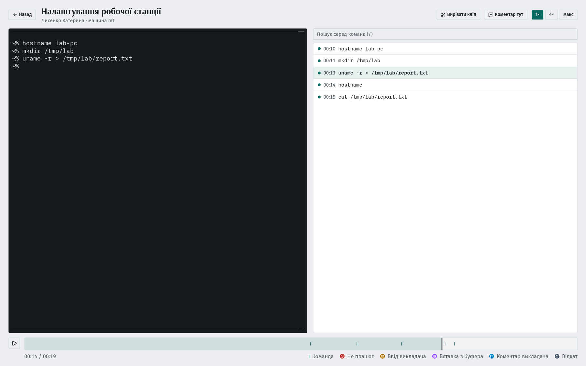

# Laplace

**Українська** | [English](README.en.md)

Linux у браузері на емуляторі [v86](https://github.com/copy/v86) з детермінованим записом і повтором сеансу. Сеанс - це журнал вхідних подій і знімки стану: його можна повторити з точністю до інструкції, перемотати, продовжити з будь-якої миті, перевірити й показати викладачеві. Машини класу з'єднані мережею між браузерами.



## Можливості

- Детерміноване ядро: той самий журнал дає той самий стан гостьової системи на будь-якому комп'ютері, і це перевіряється хешами пам'яті гостя.
- Перемотування, "продовжити звідси", відкат до будь-якої попередньої команди, програвач зі шкалою часу й пошуком команд.
- Ролі викладача й учня: класи, завдання, календар, живі термінали всієї групи, перехоплення введення учня, запити допомоги, здача робіт, оцінки, уроки з поясненнями й відрізками "спробуйте самі".
- Мережі до шести машин в одній топології: комутатори з VLAN, маршрутизатор, NAT; зв'язок між браузерами через WebRTC із запасним каналом через сервер і, за бажанням, доступ до інтернету через ретранслятор.
- Сервер сам повторює здані журнали, щоб їх перевірити.
- Образи: Buildroot, невеликий мережевий образ (iproute2, iptables, dnsmasq, tcpdump, BIRD), Alpine і навчальний образ Alpine з компіляторами й довідкою man.

## Швидкий старт

Потрібен Node.js 22 або новіший.

```
npm run setup      # встановлює залежності кореня, сервера й інтерфейсу
npm run images     # завантажує знімки стану, ядра й файлові системи в images/
npm run build      # збирає сервер і вебінтерфейс
(cd server && npm run demo:reset)   # заповнює базу демонстраційними даними
npm start          # http://127.0.0.1:8086
```

Демонстраційні облікові записи: `teacher` / `teacher-demo`, `student01` ... `student24` / `student-demo`.

`npm run images` завантажує близько 420 МБ з релізу GitHub, указаного в `images.json`. Окремі профілі: `npm run images -- study net`; інше джерело файлів задає змінна `LAPLACE_IMAGES_URL`; як зібрати образи самостійно, описано в [docs/images.md](docs/images.md) (англійською).

Стан типово зберігається в `data/` у корені репозиторію; `LAPLACE_DB` і `LAPLACE_JOURNALS` змінюють файл бази й каталог журналів, `PORT` - порт.

## Структура

| Шлях | Вміст |
|------|-------|
| `app/core/` | детерміноване ядро: `engine.mjs`, формат журналу, знімки, хеші |
| `app/machine/` | `Machine` і її Worker, системний канал гостя |
| `app/net/` | комутатор, топології, WebRTC-мережа, кімнати, клієнт ретранслятора, маршрутизатор кадрів |
| `app/profiles.mjs` | профілі образів і команди налаштування гостя |
| `app/topologies/` | приклади мережевих топологій |
| `app/*.html`, `app/ui/` | мінімальні сторінки для перевірки ядра в браузерах |
| `app/test/` | тести в Node; `app/test/browser/` керує Chromium і Firefox |
| `server/` | API на NestJS, SQLite, сховище журналів, кімнати, перевірка журналів |
| `web/` | інтерфейс на React і його наскрізні тести (`web/e2e/`) |
| `shared/` | спільні типи TypeScript для сервера й інтерфейсу |
| `v86det/` | v86 з правками для детермінізму (вихідний код `v86.wasm`) |
| `images-src/` | як зібрано образи, і правки v86 відносно основного репозиторію |
| `bench/` | заміри повтору й швидкості |
| `vendor/` | емулятор термінала (xterm.js) |
| `docs/` | [архітектура](docs/architecture.md), [образи](docs/images.md) (англійською) |

## Тести й заміри

```
npm test              # тести ядра в Node, близько 3 хвилин
npm run test:server   # тести сервера
npm run test:web      # тести інтерфейсу (Vitest)
```

Браузерним тестам потрібен Chromium або Firefox, запускають їх по одному. Спершу запишіть журнал, який вони повторюють: `npm run test:browser:prepare`; потім запускайте, наприклад, `node app/test/browser/machine.test.mjs` або `SKIP=relay_hang node app/test/browser/net.test.mjs`. Наскрізним тестам у `web/e2e/` потрібні зібрані сервер та інтерфейс (`npm run build`) і Chromium, наприклад `node web/e2e/demo.mjs`.

```
npm run bench:replay  # повтор демонстраційних журналів у Chromium (Firefox: node bench/browser/run-replay.mjs firefox)
npm run bench:speed   # швидкість емулятора
npm run bench:net     # мережа між машинами в браузері
```

## Браузери

Підтримуються Chromium і Firefox, і повтор у них однаковий: `bench:replay` перевіряє кожен хеш демонстраційних журналів у будь-якому з двох браузерів.

## Ліцензія

[AGPL-3.0-only](LICENSE). Каталог `v86det/` походить від v86 і зберігає його ліцензію ([v86det/LICENSE](v86det/LICENSE)); `vendor/LICENSE.xterm` стосується xterm.js.
